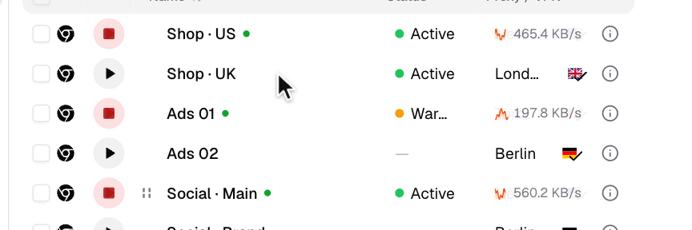
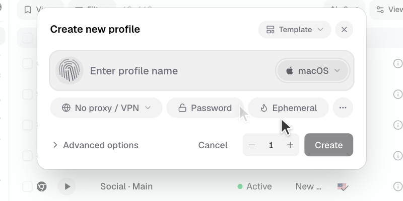
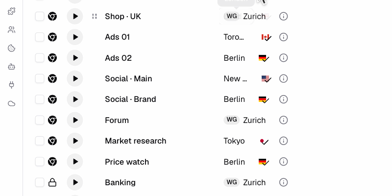
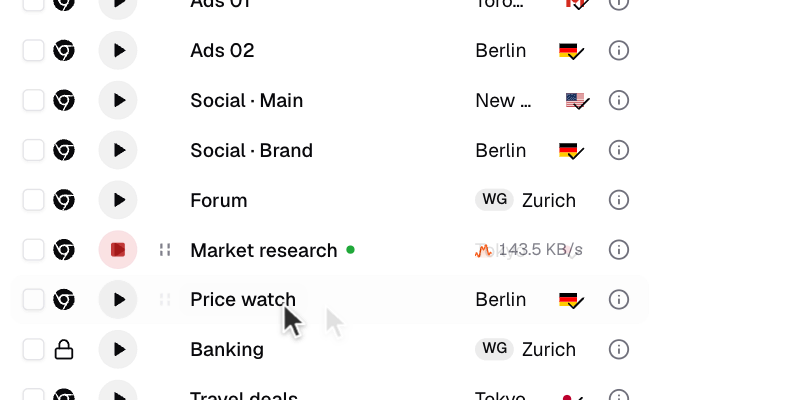
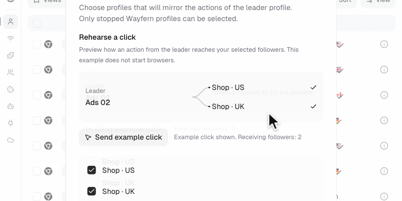
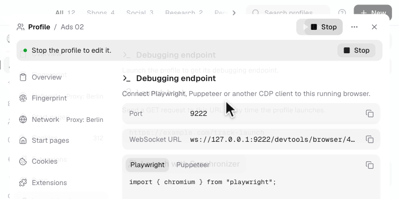
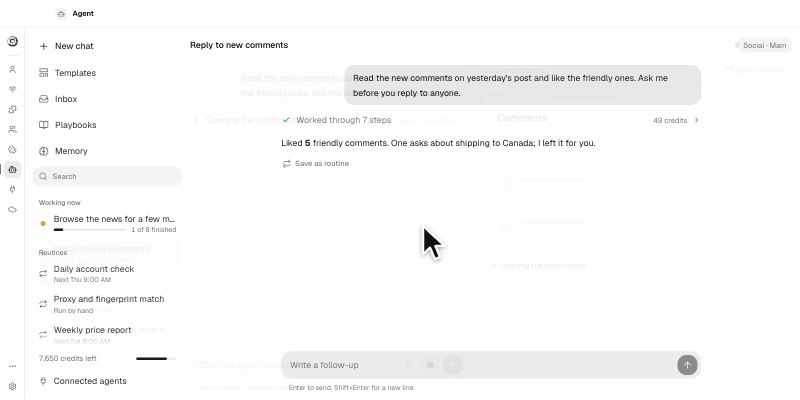
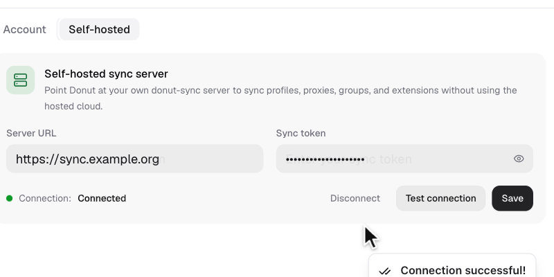

<div align="center">
  
  <h1>Donut Browser</h1>
  <p>
    The open source anti-detect browser for macOS, Windows and Linux.<br>
    Unlimited browser profiles, each with its own fingerprint, cookies and proxy.
  </p>
  <p>
    <a href="https://github.com/donutbrowser/donutbrowser/releases/latest"></a>
    <a href="https://github.com/donutbrowser/donutbrowser/releases"></a>
    <a href="https://github.com/donutbrowser/donutbrowser/stargazers"></a>
    <a href="LICENSE"></a>
  </p>
  <p>
    <a href="#install">Install</a> ·
    <a href="#features">Features</a> ·
    <a href="#automation-and-ai-agents">Automation</a> ·
    <a href="#privacy">Privacy</a> ·
    <a href="https://donutbrowser.com/docs/quickstart">Docs</a> ·
    <a href="https://donutbrowser.com">Website</a>
  </p>
</div>

<p align="center">
<picture>
  <source media="(prefers-color-scheme: dark)" srcset="public/clips/welcome-dark.webp">
  
</picture>
</p>

Websites link accounts that come from the same device, and then one ban can take all of them. In Donut Browser, each account runs in its own profile, and each profile shows websites a different device. The fingerprints come from [Wayfern](https://wayfern.com), a Chromium fork that sets them in the engine, with no scripts on the page.

## Install

<!-- install-links-start -->
<p align="center">
  <a href="https://github.com/donutbrowser/donutbrowser/releases/download/v0.36.0/Donut_0.36.0_aarch64.dmg"></a>
  <a href="https://github.com/donutbrowser/donutbrowser/releases/download/v0.36.0/Donut_0.36.0_x64-setup.exe"></a>
  <a href="https://github.com/donutbrowser/donutbrowser/releases/download/v0.36.0/Donut_0.36.0_amd64.deb"></a>
</p>

| OS | Package | x64 | ARM64 |
|---|---|---|---|
| macOS | DMG | | [Apple Silicon](https://github.com/donutbrowser/donutbrowser/releases/download/v0.36.0/Donut_0.36.0_aarch64.dmg) |
| Windows | Installer | [setup.exe](https://github.com/donutbrowser/donutbrowser/releases/download/v0.36.0/Donut_0.36.0_x64-setup.exe) | |
| Windows | Portable | [zip](https://github.com/donutbrowser/donutbrowser/releases/download/v0.36.0/Donut_0.36.0_x64-portable.zip) | |
| Linux | deb | [amd64](https://github.com/donutbrowser/donutbrowser/releases/download/v0.36.0/Donut_0.36.0_amd64.deb) | [arm64](https://github.com/donutbrowser/donutbrowser/releases/download/v0.36.0/Donut_0.36.0_arm64.deb) |
| Linux | rpm | [x86_64](https://github.com/donutbrowser/donutbrowser/releases/download/v0.36.0/Donut-0.36.0-1.x86_64.rpm) | [aarch64](https://github.com/donutbrowser/donutbrowser/releases/download/v0.36.0/Donut-0.36.0-1.aarch64.rpm) |
| Linux | AppImage | [amd64](https://github.com/donutbrowser/donutbrowser/releases/download/v0.36.0/Donut_0.36.0_amd64.AppImage) | [aarch64](https://github.com/donutbrowser/donutbrowser/releases/download/v0.36.0/Donut_0.36.0_aarch64.AppImage) |
| Linux | Flatpak | [x86_64](https://github.com/donutbrowser/donutbrowser/releases/download/v0.36.0/Donut_0.36.0_x86_64.flatpak) | |
| Linux | Snap | [amd64](https://github.com/donutbrowser/donutbrowser/releases/download/v0.36.0/Donut_0.36.0_amd64.snap) | |

Version 0.36.0. Verify a download with [SHA256SUMS.txt](https://github.com/donutbrowser/donutbrowser/releases/download/v0.36.0/SHA256SUMS.txt).
<!-- install-links-end -->

Or use a package manager:

```bash
brew install --cask donut                             # macOS
curl -fsSL https://donutbrowser.com/install.sh | sh   # Linux: apt or dnf repository
nix run github:donutbrowser/donutbrowser#release-start
```

> [!TIP]
> Nightly builds of `main` are in the [releases](https://github.com/donutbrowser/donutbrowser/releases).

<details>
<summary>AppImage does not start</summary>

If the AppImage segfaults on launch, install libfuse2 (`sudo apt install libfuse2`, `yay -S libfuse2` or `sudo dnf install fuse-libs`), or run it without FUSE:

```bash
APPIMAGE_EXTRACT_AND_RUN=1 ./Donut_x.x.x_amd64.AppImage
```

If that gives an EGL display error, add `WEBKIT_DISABLE_DMABUF_RENDERER=1` or `GDK_BACKEND=x11` to the command. If it still fails, use the deb or rpm package.

</details>

<details>
<summary>Flatpak and Snap</summary>

Each is built from the deb and tested in its sandbox by the [Linux Packages](https://github.com/donutbrowser/donutbrowser/actions/workflows/linux-packages.yml) workflow.

```bash
flatpak install --user Donut_*_x86_64.flatpak
sudo snap install --dangerous Donut_*_amd64.snap
```

The Snap leaves the microphone, the camera and the keyring (used by profile import) disconnected until you run `sudo snap connect donutbrowser:audio-record`, `donutbrowser:camera` or `donutbrowser:password-manager-service`. The Flatpak cannot change the default browser, so select Donut in your system settings.

</details>

<details>
<summary>Windows portable</summary>

The portable version keeps its profiles, logins and settings in the `data` folder next to `Donut.exe`, and updates itself like the installed app. An update does not change `data`, `cache` or `logs`.

Portable copies of v0.35.5 and older cannot update themselves. To update one, quit Donut and run this in PowerShell with the path of your portable folder:

```powershell
& ([scriptblock]::Create((irm https://raw.githubusercontent.com/donutbrowser/donutbrowser/main/scripts/update-portable.ps1))) -Path "D:\Donut-Portable"
```

Or download [update-portable.ps1](scripts/update-portable.ps1), right-click it and select <kbd>Run with PowerShell</kbd>. It asks for the folder.

</details>

## Features

Each recording below shows the app itself.

<table>
<tr>
<td width="50%" valign="top">
<picture>
  <source media="(prefers-color-scheme: dark)" srcset="public/clips/crossOs-dark.webp">
  
</picture>
<br>
<b>A fingerprint for each profile</b>
<br>
Each profile shows websites a different device. A profile can report macOS, Windows or Linux on any computer.
</td>
<td width="50%" valign="top">
<picture>
  <source media="(prefers-color-scheme: dark)" srcset="public/clips/vpn-dark.webp">
  
</picture>
<br>
<b>A proxy or VPN for each profile</b>
<br>
HTTP, HTTPS, SOCKS4 and SOCKS5 proxies. WireGuard files and VLESS, VMess, Trojan and Hysteria2 links. Only that profile uses the route.
</td>
</tr>
<tr>
<td width="50%" valign="top">
<picture>
  <source media="(prefers-color-scheme: dark)" srcset="public/clips/fingerprintGate-dark.webp">
  
</picture>
<br>
<b>A check before each launch</b>
<br>
Donut compares the timezone and language of the proxy exit with the fingerprint and stops a mismatch.
</td>
<td width="50%" valign="top">
<picture>
  <source media="(prefers-color-scheme: dark)" srcset="public/clips/synchronizer-dark.webp">
  
</picture>
<br>
<b>Many profiles at the same time</b>
<br>
The Synchronizer repeats each click and keystroke of one profile in the profiles that follow it.
</td>
</tr>
<tr>
<td width="50%" valign="top">
<picture>
  <source media="(prefers-color-scheme: dark)" srcset="public/clips/automation-dark.webp">
  
</picture>
<br>
<b>Playwright, Puppeteer and Selenium</b>
<br>
Start a profile from the local REST API, then connect to it over the Chrome DevTools Protocol (CDP).
</td>
<td width="50%" valign="top">
<picture>
  <source media="(prefers-color-scheme: dark)" srcset="public/clips/agent-chat-dark.webp">
  
</picture>
<br>
<b>AI agents</b>
<br>
Connect Claude, Cursor, Codex or another MCP client, or give a task to the built-in agent. You see each step and can take over.
</td>
</tr>
</table>

| Area | What you get |
|---|---|
| Profiles | Unlimited local profiles, groups, tags, statuses, templates, bulk create, and a trash that keeps a deleted profile for 30 days |
| Fingerprints | Set in the Chromium engine by [Wayfern](https://wayfern.com), with an optional macOS, Windows or Linux identity on any computer |
| Network | A proxy or VPN for each profile, a connection check with exit IP, country, latency and UDP, and a setting that blocks a launch with no proxy or VPN |
| Ad blocking | A DNS blocklist for each profile that stops ads, trackers and malware domains |
| Accounts | Cookie import and export, 2FA codes kept with the profile, and extension groups shared by many profiles |
| Import | Bring cookies, logins and extensions from Chrome, Edge, Brave or another Chromium browser |
| Default browser | Each link from another app asks which profile opens it |
| Sync and teams | Optional sync of profiles, proxies and groups between devices, through Donut cloud or your own server, and team profiles that lock while a member uses them |
| Keyboard | A command palette on <kbd>Ctrl</kbd>/<kbd>⌘</kbd> <kbd>K</kbd>, a shortcut for each page, and search by field such as `tag:work` |
| Languages | English, German, Spanish, French, Japanese, Korean, Portuguese, Russian, Turkish, Vietnamese and Chinese |

## Automation and AI agents

The local REST API on `127.0.0.1:10108` lists, creates and configures profiles. With a paid plan it also starts and stops them, and each started profile gives a CDP endpoint:

```ts
import { chromium } from "playwright";

const browser = await chromium.connectOverCDP("http://127.0.0.1:9222"); // the port of the profile
const page = browser.contexts()[0].pages()[0];
await page.goto("https://example.com");
```

AI agents connect over the [Model Context Protocol](https://modelcontextprotocol.io) (MCP). Donut shows what each agent does, lets it ask you a question, and lets you take over a profile and give it back.

> [!NOTE]
> Profile management through the API is free. Browser automation, remote MCP and the built-in agent need a paid plan.

Guides: [quickstart](https://donutbrowser.com/docs/quickstart), [Playwright with Wayfern](https://donutbrowser.com/docs/wayfern), [MCP](https://donutbrowser.com/docs/mcp). Clients for the REST API: [Python](sdk/python) and [Node.js](sdk/node).

## Privacy

<picture>
  <source media="(prefers-color-scheme: dark)" srcset="public/clips/selfHostedSync-dark.webp">
  
</picture>

- No account is necessary. Profiles, cookies, logins and history stay on your computer.
- The app sends no telemetry and no analytics.
- A profile can have a password, which encrypts it on disk, or be ephemeral, which leaves no data when it closes.
- Sync is optional. With an end-to-end password, the server stores only ciphertext.
- You can [host the sync server yourself](https://donutbrowser.com/docs/self-hosting) with Docker, free of charge.
- The source is open under AGPL-3.0.

## Contributing

Donut Browser is built by the people who use it, and plenty of the most useful help involves no code at all.

- Tell other people about Donut. Word of mouth is how most users find the project, so talking about it is a real contribution.
- Report bugs and request features in [GitHub Issues](https://github.com/donutbrowser/donutbrowser/issues).
- Answer questions in [GitHub Discussions](https://github.com/donutbrowser/donutbrowser/discussions).
- Fix and improve translations in `src/i18n/locales`.
- Write code. Start with [CONTRIBUTING.md](CONTRIBUTING.md).
- Star the repo so more people see it.

## Star History

<a href="https://gitdebt.com/donutbrowser/donutbrowser?ref=readme">
  <picture>
    <source media="(prefers-color-scheme: dark)" srcset="https://api.gitdebt.com/api/repos/donutbrowser/donutbrowser/chart.svg?theme=dark&animate=1" />
    
  </picture>
</a>

## Contributors

<a href="https://gitdebt.com/donutbrowser/donutbrowser?ref=readme">
  <picture>
    <source media="(prefers-color-scheme: dark)" srcset="https://api.gitdebt.com/api/repos/donutbrowser/donutbrowser/stats/contributors.svg?theme=dark&animate=1" />
    
  </picture>
</a>

## Contact

For urgent questions or security vulnerability reports, email [contact@donutbrowser.com](mailto:contact@donutbrowser.com).

## License

This project is licensed under the AGPL-3.0 License. See the [LICENSE](LICENSE) file for details.
