<div align="center">
  <picture>
    <source media="(prefers-color-scheme: dark)" srcset="assets/readme/logo-dark.svg">
    
  </picture>
  <h1>Donut Browser</h1>
  <p>Open-source anti-detect browser. Unlimited profiles on one computer, each with its own fingerprint, cookies and proxy.</p>
  <p>Zero app telemetry · No account needed · Profiles stored on your disk · Optional end-to-end encrypted sync</p>
  <p>
    <a href="https://github.com/donutbrowser/donutbrowser/releases/latest"></a>
    <a href="https://github.com/donutbrowser/donutbrowser/releases"></a>
    <a href="https://github.com/donutbrowser/donutbrowser/stargazers"></a>
    <a href="LICENSE"></a>
    <a href="https://github.com/donutbrowser/donutbrowser/issues"></a>
  </p>
  <p>
    <a href="#install"></a>
  </p>
  <p>
    <a href="https://donutbrowser.com">Website</a> ·
    <a href="https://donutbrowser.com/docs">Docs</a> ·
    <a href="https://donutbrowser.com/pricing">Pricing</a> ·
    <a href="CHANGELOG.md">Changelog</a>
  </p>
</div>

<p align="center">
  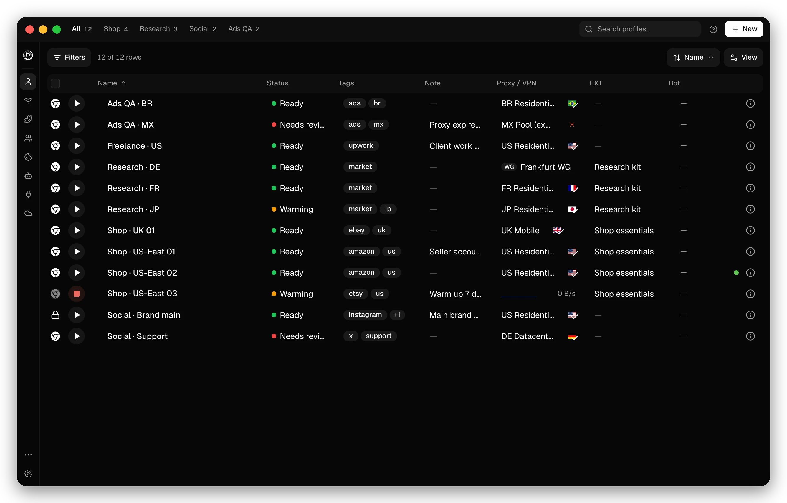
</p>

## Your accounts never meet


Websites link accounts that come from the same device, and one ban then takes them all. In Donut, each account runs in its own profile, so every site sees a different device.

## Every profile is a separate device


Each profile has its own fingerprint, cookies, extensions and proxy or VPN. WebRTC and DNS use the profile's route. Before a launch, Donut compares the timezone and language of the proxy exit with the fingerprint and stops a mismatch.

The fingerprints come from [Wayfern](https://wayfern.com), a Chromium fork that sets them inside the engine. Cloudflare, reCAPTCHA v3 and other anti-bot services do not detect them.

## Private at every layer


- No account needed. Profiles, cookies, logins and history stay on your computer.
- Zero app telemetry. No usage data, crash reports or device IDs leave the app.
- A password-locked profile is encrypted on disk and decrypted only while it runs.
- An ephemeral profile keeps its data in memory and is discarded when the browser closes. Clear on close drops cookies, storage and history when the window closes.
- A deleted profile waits 30 days in the trash. Permanent deletion overwrites every file.
- One setting blocks every launch without a proxy or VPN, so no profile starts from your own IP.
- Sync is optional and end-to-end encrypted with a password only you know. Use Donut Sync or [run your own server](#self-host-sync).

## Features

<table>
  <tr>
    <td width="50%" valign="top">
      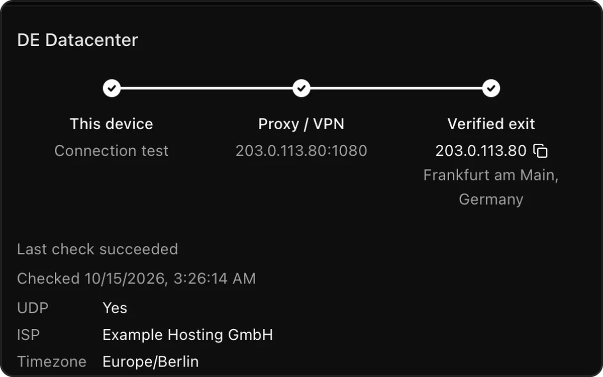
      <h3>Proxies and VPNs</h3>
      <p>HTTP, HTTPS, SOCKS4 and SOCKS5 proxies, dynamic proxy URLs, WireGuard, and VLESS, VMess, Trojan and Hysteria2 links. A check shows the exit IP, location, latency and UDP support.</p>
    </td>
    <td width="50%" valign="top">
      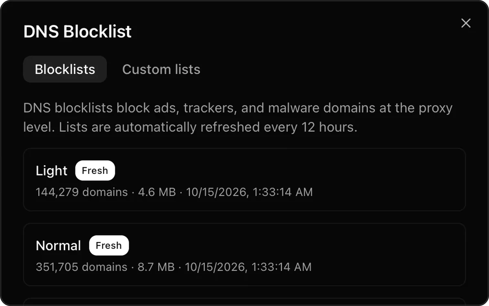
      <h3>DNS blocklists</h3>
      <p>Block ads, trackers and malware domains per profile, with no extension. Pick one of five levels, or add your own lists and an allowlist.</p>
    </td>
  </tr>
  <tr>
    <td width="50%" valign="top">
      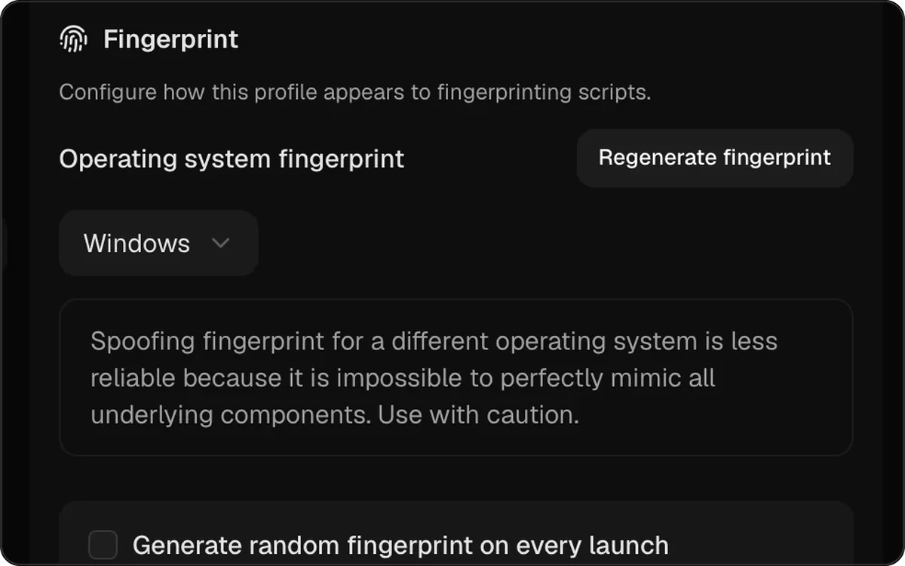
      <h3>Fingerprints</h3>
      <p>Regenerate a profile's fingerprint, or get a new one at every launch. With Pro or Team, a profile can present macOS, Windows or Linux on any computer.</p>
    </td>
    <td width="50%" valign="top">
      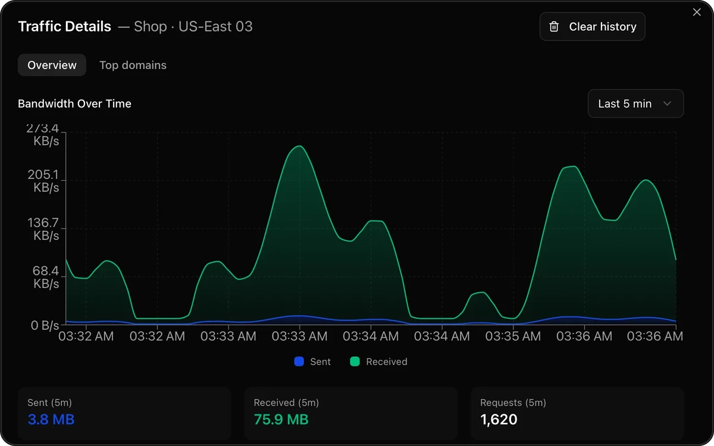
      <h3>Traffic</h3>
      <p>Bandwidth, requests and top domains for each profile. Turn off site recording to keep only data totals.</p>
    </td>
  </tr>
  <tr>
    <td width="50%" valign="top">
      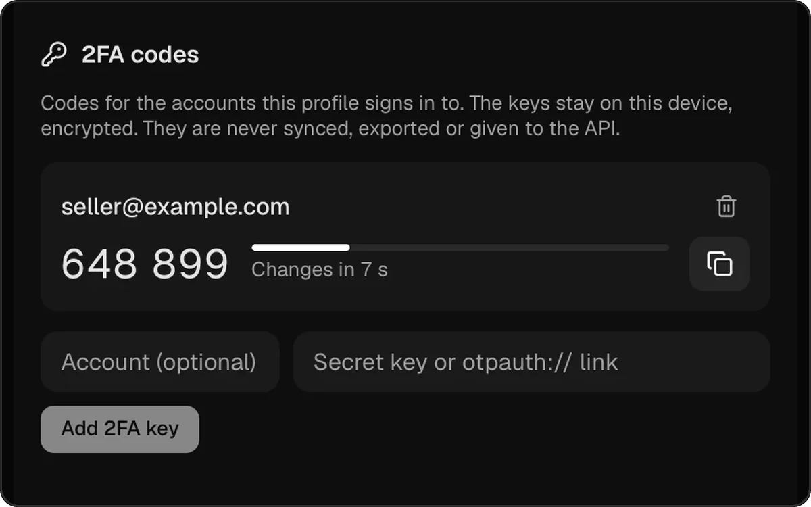
      <h3>2FA codes</h3>
      <p>Keep each account's 2FA key with its profile and copy the current code. The keys stay encrypted on your device and are never synced.</p>
    </td>
    <td width="50%" valign="top">
      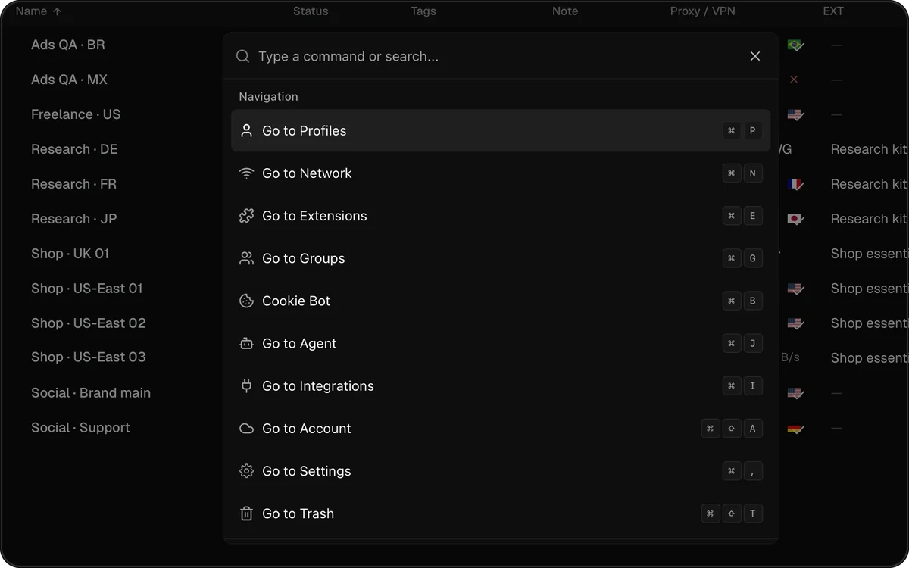
      <h3>Command palette</h3>
      <p>Press <kbd>⌘</kbd> <kbd>K</kbd> or <kbd>Ctrl</kbd> <kbd>K</kbd> to open a page, start or stop a profile, or run an action. Every page has its own shortcut.</p>
    </td>
  </tr>
</table>

Also in the app:

- Groups, tags, notes, statuses, and templates that create many profiles at once.
- Import profiles from Chrome, Edge, Brave or another Chromium browser, with cookies, logins and extensions.
- Import and export cookies, including Playwright `storageState` files.
- Add extensions from a Chrome Web Store link, a `.crx` or `.zip` file, or an unpacked folder, and share one set across profiles.
- Set Donut as your default browser and choose which profile opens each link.
- The interface is in 11 languages.

## Automate with code or AI agents


Start any profile from the local REST API on `127.0.0.1:10108`, then connect Playwright, Puppeteer or Selenium over CDP. The [`sdk`](sdk) folder has Python and Node clients. Connect Claude Code, Cursor, Codex or another client over remote [MCP](https://modelcontextprotocol.io) to let an agent work in your profiles. Donut has no AI model of its own. Remote MCP needs a paid plan. Starting profiles from the API and the Synchronizer need Pro or Team.

Guides: [quickstart](https://donutbrowser.com/docs/quickstart), [Playwright with Wayfern](https://donutbrowser.com/docs/wayfern), [MCP](https://donutbrowser.com/docs/mcp).

<table>
  <tr>
    <td width="50%" valign="top">
      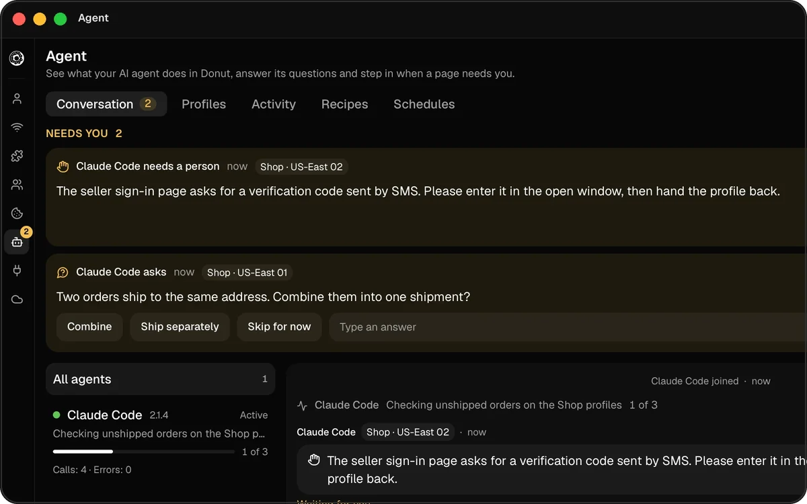
      <h3>Agent console</h3>
      <p>See what each connected agent does, answer its questions, and take over a profile and hand it back. One switch pauses all agents.</p>
    </td>
    <td width="50%" valign="top">
      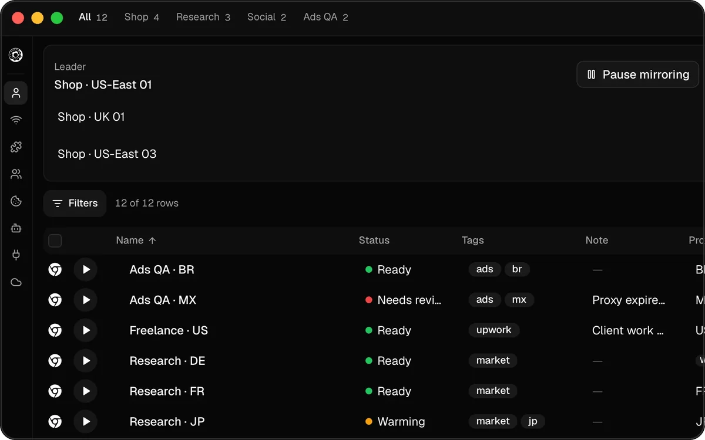
      <h3>Synchronizer</h3>
      <p>Every click and keystroke in a leader profile repeats in the followers you pick. Hold one follower out, or arrange all windows in a grid.</p>
    </td>
  </tr>
</table>

## Plans

The app is free, with unlimited local profiles. Paid plans add cloud features and automation. Prices are on the [pricing page](https://donutbrowser.com/pricing).

<table>
  <tr>
    <th width="25%">Free</th>
    <th width="25%">Solo</th>
    <th width="25%">Pro</th>
    <th width="25%">Team</th>
  </tr>
  <tr>
    <td valign="top">Unlimited local profiles<br>Proxies, VPNs and DNS blocklists<br>Local REST API<br>Self-hosted sync</td>
    <td valign="top">Everything in Free<br>Encrypted cloud backup<br>Cookie Bot<br>Scheduled recipes<br>Remote MCP for AI agents</td>
    <td valign="top">Everything in Solo<br>Browser automation API<br>Cross-OS fingerprints<br>Synchronizer<br>Remote browser sessions</td>
    <td valign="top">Everything in Pro<br>Shared profiles<br>Access by profile group<br>Team activity log</td>
  </tr>
</table>

<table>
  <tr>
    <td width="50%" valign="top">
      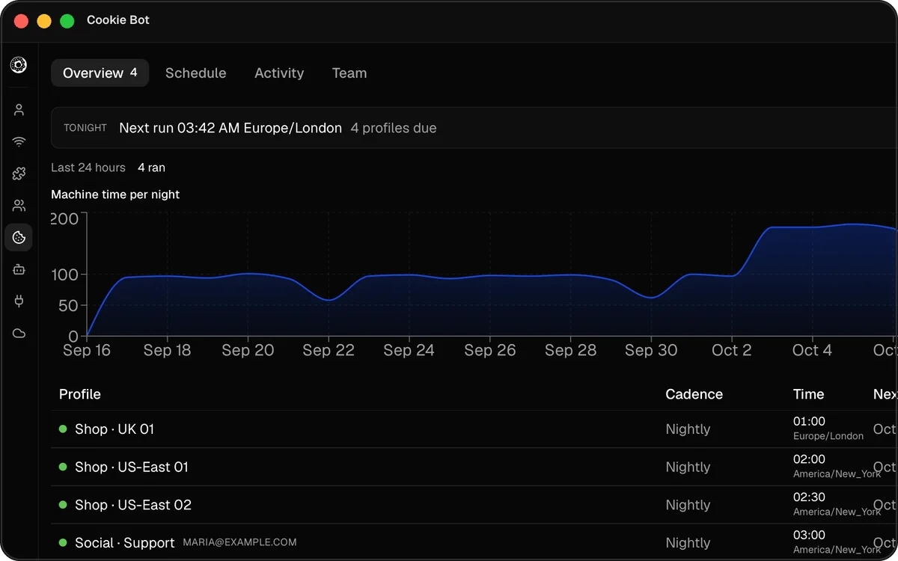
      <h3>Cookie Bot</h3>
      <p>Browses real sites on a schedule from a remote host, so a new profile builds a natural history before you use it.</p>
    </td>
    <td width="50%" valign="top">
      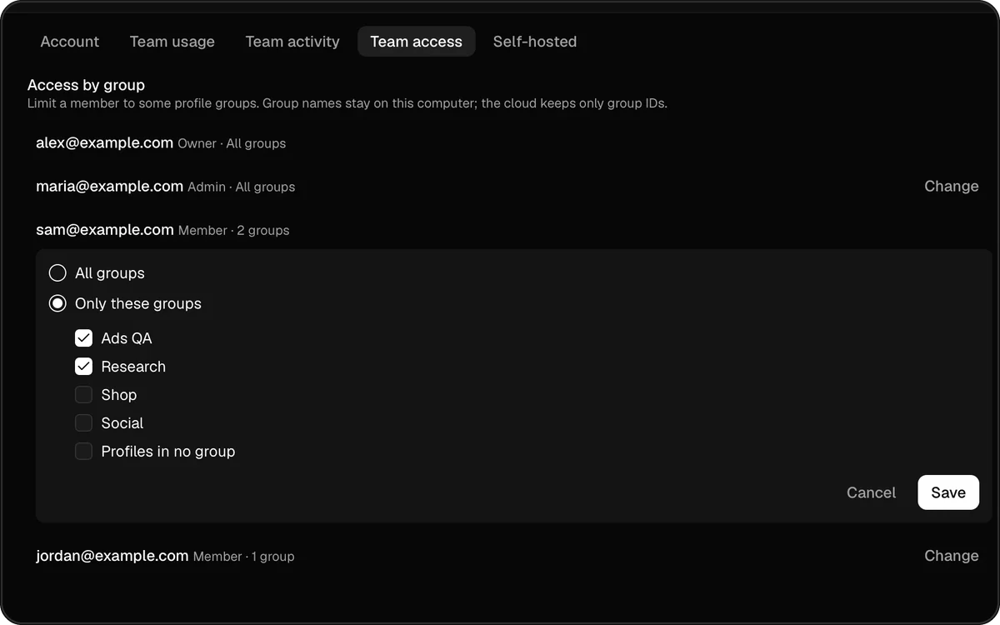
      <h3>Team</h3>
      <p>A running profile is locked for everyone else. Limit each member to some profile groups, and see who changed what.</p>
    </td>
  </tr>
</table>

## Install

<!-- install-links-start -->
### macOS

[Download DMG (Apple Silicon)](https://github.com/donutbrowser/donutbrowser/releases/download/v0.34.0/Donut_0.34.0_aarch64.dmg)

Or install via Homebrew:

```bash
brew install --cask donut
```

### Windows

[Download Windows Installer (x64)](https://github.com/donutbrowser/donutbrowser/releases/download/v0.34.0/Donut_0.34.0_x64-setup.exe) · [Portable (x64)](https://github.com/donutbrowser/donutbrowser/releases/download/v0.34.0/Donut_0.34.0_x64-portable.zip)

### Linux

| Format | x86_64 | ARM64 |
|---|---|---|
| **deb** | [Download](https://github.com/donutbrowser/donutbrowser/releases/download/v0.34.0/Donut_0.34.0_amd64.deb) | [Download](https://github.com/donutbrowser/donutbrowser/releases/download/v0.34.0/Donut_0.34.0_arm64.deb) |
| **rpm** | [Download](https://github.com/donutbrowser/donutbrowser/releases/download/v0.34.0/Donut-0.34.0-1.x86_64.rpm) | [Download](https://github.com/donutbrowser/donutbrowser/releases/download/v0.34.0/Donut-0.34.0-1.aarch64.rpm) |
| **AppImage** | [Download](https://github.com/donutbrowser/donutbrowser/releases/download/v0.34.0/Donut_0.34.0_amd64.AppImage) | [Download](https://github.com/donutbrowser/donutbrowser/releases/download/v0.34.0/Donut_0.34.0_aarch64.AppImage) |
<!-- install-links-end -->

On 64-bit Linux, the install script adds the Donut apt or rpm repository, so updates come through your package manager. For a per-user AppImage, end the command with `sh -s -- --appimage`.

```bash
curl -fsSL https://donutbrowser.com/install.sh | sh
```

<details>
<summary>Troubleshooting AppImage</summary>

If the AppImage segfaults on launch, install libfuse2 (`sudo apt install libfuse2` / `yay -S libfuse2` / `sudo dnf install fuse-libs`), or bypass FUSE entirely:

```bash
APPIMAGE_EXTRACT_AND_RUN=1 ./Donut.Browser_x.x.x_amd64.AppImage
```

If that gives an EGL display error, add `WEBKIT_DISABLE_DMABUF_RENDERER=1` or `GDK_BACKEND=x11` to the command above. If issues persist, the .deb and .rpm packages are more reliable.

</details>

### Flatpak and Snap

Releases include an x86_64 Flatpak bundle and a Snap, built from the `.deb` and tested in their sandboxes by the [Linux Packages](https://github.com/donutbrowser/donutbrowser/actions/workflows/linux-packages.yml) workflow. Download `Donut_*_x86_64.flatpak` or `Donut_*_amd64.snap` from the [releases](https://github.com/donutbrowser/donutbrowser/releases) (the nightly has them already) and install it:

```bash
flatpak install --user Donut_*_x86_64.flatpak
sudo snap install --dangerous Donut_*_amd64.snap
```

The Snap leaves the microphone, the camera and the keyring (used by profile import) disconnected until you run `sudo snap connect donutbrowser:audio-record`, `donutbrowser:camera` or `donutbrowser:password-manager-service`. The Flatpak cannot change the default browser, so choose Donut in your system settings instead.

### Nix

```bash
nix run github:donutbrowser/donutbrowser#release-start
```

## Run from source

```bash
git clone https://github.com/donutbrowser/donutbrowser.git
cd donutbrowser
pnpm install
pnpm tauri dev
```

This needs Node.js (version in `.node-version`), pnpm, stable Rust and the [Tauri v2 prerequisites](https://v2.tauri.app/start/prerequisites/). With Nix, run `nix run .#setup` and then `nix run .#tauri-dev`. See [CONTRIBUTING.md](CONTRIBUTING.md).

## Self-host sync

Run your own sync server to sync profiles, proxies and groups across devices for free. The server is in [`donut-sync`](donut-sync) and ships as the `donutbrowser/donut-sync` Docker image. See the [self-hosting guide](https://donutbrowser.com/docs/self-hosting).

## Contributing

Most of the useful help needs no code.

- Tell other people about Donut. Most users find it by word of mouth.
- Report bugs and request features in [GitHub Issues](https://github.com/donutbrowser/donutbrowser/issues).
- Answer questions in [GitHub Discussions](https://github.com/donutbrowser/donutbrowser/discussions).
- Fix and improve translations in `src/i18n/locales`.
- Write code. Start with [CONTRIBUTING.md](CONTRIBUTING.md).
- Star the repo so more people see it.

## Star history

<a href="https://gitdebt.com/donutbrowser/donutbrowser?ref=readme">
  <picture>
    <source media="(prefers-color-scheme: dark)" srcset="https://api.gitdebt.com/api/repos/donutbrowser/donutbrowser/chart.svg?theme=dark&animate=1" />
    
  </picture>
</a>

## Contributors

<a href="https://gitdebt.com/donutbrowser/donutbrowser?ref=readme">
  <picture>
    <source media="(prefers-color-scheme: dark)" srcset="https://api.gitdebt.com/api/repos/donutbrowser/donutbrowser/stats/contributors.svg?theme=dark&animate=1" />
    
  </picture>
</a>

## Contact

For urgent questions or security vulnerability reports, email [contact@donutbrowser.com](mailto:contact@donutbrowser.com).

## License

AGPL-3.0. See [LICENSE](LICENSE).
